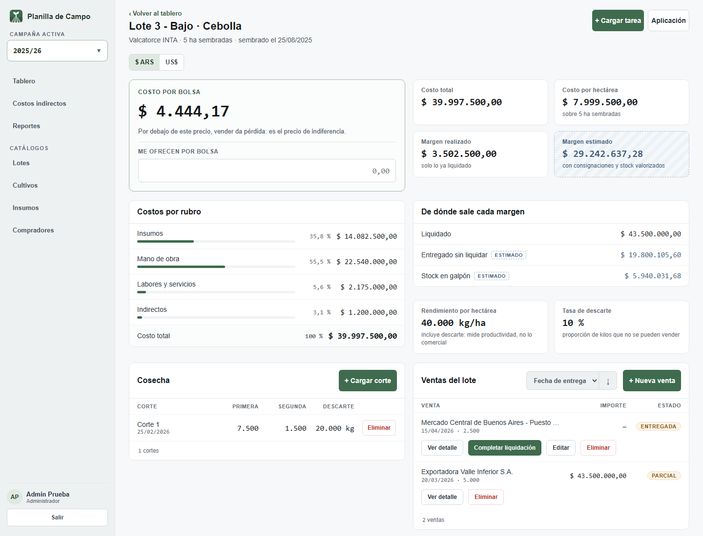
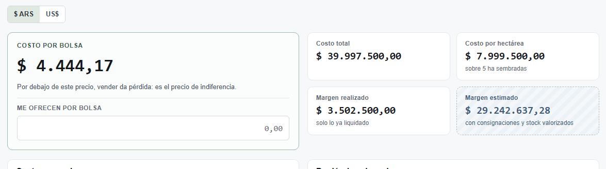
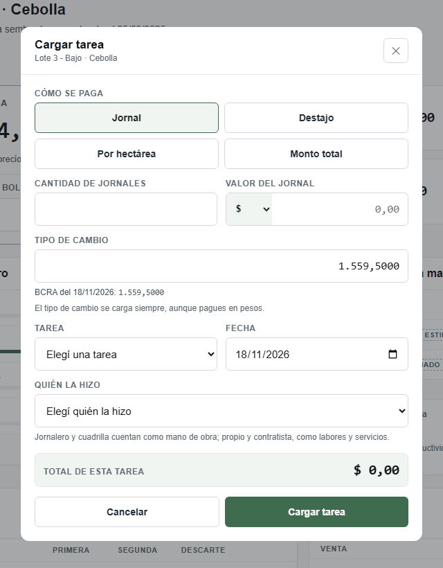
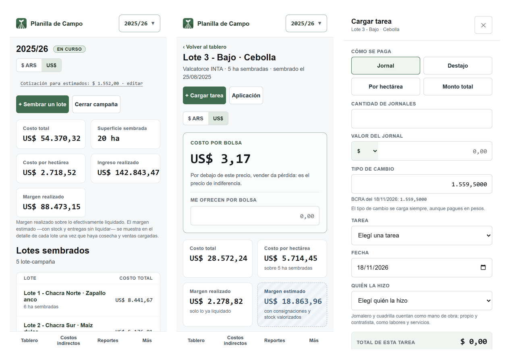
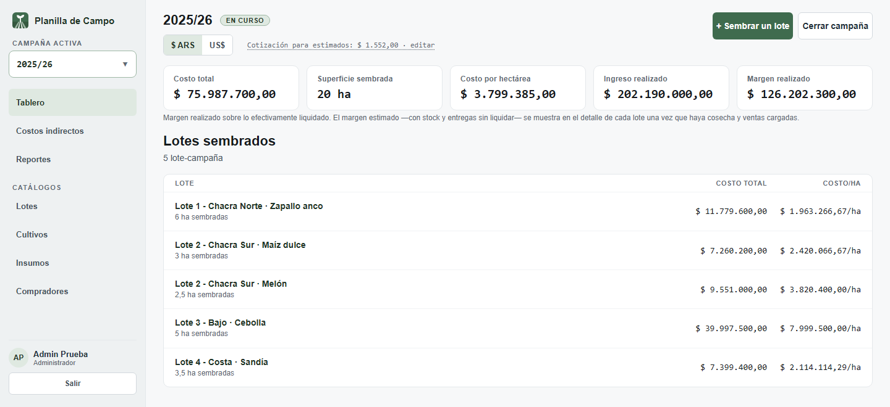
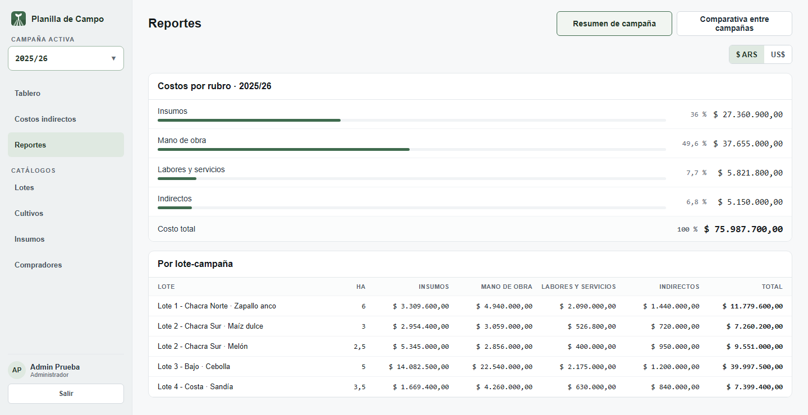

# Planilla de Campo - Frontend

**Aplicación web para que un productor hortícola sepa cuánto le cuesta producir y si le conviene vender.** Registra insumos, tareas, cosechas y ventas de cada lote, y muestra costos y márgenes **realizados** y **estimados** por lote y por campaña (cebolla, zapallo, maíz, melón, sandía).

> Backend (Spring Boot + MySQL): [planilla-campo-backend](https://github.com/rodrigocalizayadev/planilla-campo-backend) · El backend calcula todos los importes; este frontend los muestra.



## Qué resuelve

Lo construí para el negocio hortícola de mi familia, que costeaba las campañas en planillas. Responde tres preguntas que antes llevaban horas de cuentas:

| Pregunta del productor | Dónde la responde la app |
|---|---|
| ¿Cuánto me cuesta producir cada bolsa? | Costo por bolsa del lote, con el desglose por rubro |
| ¿Me conviene aceptar esta oferta? | Simulador "me ofrecen por bolsa": ganancia o pérdida al instante |
| ¿Cómo viene la campaña? | Tablero y reportes, separando lo **realizado** de lo **estimado** |

La interfaz está pensada para un productor, no para un contador: cargar un movimiento tiene que ser rápido y los números tienen que leerse de un vistazo.

## En acción

**Decidir una venta.** El costo por bolsa es el precio de indiferencia. Al tipear una oferta, la app indica si se gana o se pierde, por bolsa y sobre el stock. Todo se puede ver en pesos o en dólares.



**Cargar una tarea.** El formulario se adapta a cómo se paga la tarea (jornal, destajo, por hectárea o monto total) y muestra el total en vivo antes de guardar. El tipo de cambio se autocompleta con la cotización del BCRA.



**En el celular.** Una sola app responsive: en el campo se carga desde el teléfono, con navegación inferior y formularios a pantalla completa.



<details>
<summary>Más capturas: tablero y reporte de la campaña</summary>

Tablero de la campaña activa:



Reporte de costos por rubro de la campaña:



</details>

> Todas las capturas usan datos de prueba de la base local de desarrollo.

## Destacados técnicos

- **Angular moderno:** standalone, zoneless, Signals y Signal Forms, con TypeScript estricto.
- **Diseño propio, validado con el usuario real.** Primero hice un prototipo con el usuario con asistencia de Claude Design ([`docs/design-reference/`](docs/design-reference/)) y recién después lo implementé.
- **Cero lógica de negocio duplicada.** Los cálculos de dinero viven solo en el backend. Los importes viajan como string para no perder precisión con `Number`.
- **Estimado ≠ confirmado.** Todo valor estimado tiene un tratamiento visual propio (fondo rayado y badge "ESTIMADO"), porque confundirlos lleva a malas decisiones de venta.
- **CI/CD:** cada PR corre lint, tests con Vitest y build de producción. Cada merge a `master` publica una imagen Docker y la despliega automáticamente.

## Cómo se construyó

Lo desarrollé con Claude Code como asistente de programación. Las decisiones de producto, de dominio y de diseño son mías. Las reglas que el agente debe respetar (ver "Reglas que no se negocian") están en [`CLAUDE.md`](CLAUDE.md), y las decisiones de arquitectura compartidas están en los [ADRs del backend](https://github.com/rodrigocalizayadev/planilla-campo-backend/tree/master/docs/adr).

## Estado

**MVP funcional de punta a punta.** La hoja de ruta está en el [README del backend](https://github.com/rodrigocalizayadev/planilla-campo-backend#estado).

## Inicio rápido

Requisitos: Node.js con npm 11 y el backend corriendo en `http://localhost:8080`.

```bash
npm install
npm start          # http://localhost:4200
```

`/api/**` se proxea a `:8080` mediante [proxy.conf.json](proxy.conf.json). Si lo modificás, reiniciá el dev server.

Usuarios de desarrollo (base local):

| Rol | Email | Contraseña |
|---|---|---|
| ADMIN | `admin@planillacampo.com` | `Admin1234` |
| OPERADOR | `operador@planillacampo.com` | `Operador1234` |

> Usuarios de la base local de desarrollo, creados por el seed. No existen en ningún entorno desplegado.

> Para probar catálogos con precio (insumos, cultivos) usá ADMIN: el rol OPERADOR recibe `401`.

## Comandos

| Comando | Qué hace |
|---|---|
| `npm start` | Servidor de desarrollo |
| `npm test` | Tests unitarios con Vitest |
| `npm run build` | Build de producción en `dist/` |
| `npm run lint` | ESLint (angular-eslint) |

## Stack

| Área | Tecnología |
|---|---|
| Framework | Angular 22, standalone, zoneless |
| Formularios | Signal Forms |
| Estado | Signals (RxJS solo donde aporta) |
| Lenguaje | TypeScript estricto |
| Estilos | SCSS, diseño propio (sin librería de componentes) |
| Tests | Vitest + jsdom |

## Estructura

Carpetas por feature, espejando el backend, con rutas lazy.

```
src/app/
├── core/       auth, interceptors, guards, config, cliente HTTP
├── shared/     componentes de UI, pipes de formato, estilos
├── layout/     shell, navegación, selector de campaña activa
├── models/     tipos que espejan los DTOs del backend
└── features/
    ├── auth/  tablero/  campania/  lote-campania/
    ├── costos-indirectos/  reportes/
    └── catalogos/   (lotes, cultivos, insumos, compradores)
```

## Reglas que no se negocian

| Regla | Detalle |
|---|---|
| Sin cálculo de plata en el front | Costos y márgenes vienen del backend. Única excepción: total en vivo de un formulario antes de guardar. |
| `BigDecimal` como string | Los importes viajan como string JSON; nunca `Number(...)` al armar un payload. |
| Fechas | La API usa ISO-8601. Nunca `new Date("2026-03-15")`; la UI muestra `dd/MM/yyyy`. |
| Enums desde la API | Se cargan de `GET /api/metadata/enums`; no se hardcodean. |
| Estimados | Tienen tratamiento visual propio (fondo rayado + badge "ESTIMADO"). |
| Idioma | Interfaz en español rioplatense; identificadores sin `ñ` ni acentos. |

## Documentación

| Archivo | Contenido |
|---|---|
| [docs/dominio.md](docs/dominio.md) | Glosario y semántica del negocio (leer primero) |
| [docs/design-brief.md](docs/design-brief.md) | Usuarios, dirección visual, pantallas |
| [docs/reglas-calculo.md](docs/reglas-calculo.md) | Fórmulas de costo y margen |
| [docs/api-endpoints-v2.md](docs/api-endpoints-v2.md) | Contrato de la API |
| [docs/plan-frontend.md](docs/plan-frontend.md) | Slices de desarrollo |
| [docs/resumen-slices.md](docs/resumen-slices.md) | Bitácora de lo construido por slice |
| [docs/design-reference/](docs/design-reference/) | Prototipo validado con el usuario (especificación, no código a portar) |

Las convenciones de código y de verificación visual están en [CLAUDE.md](CLAUDE.md).
